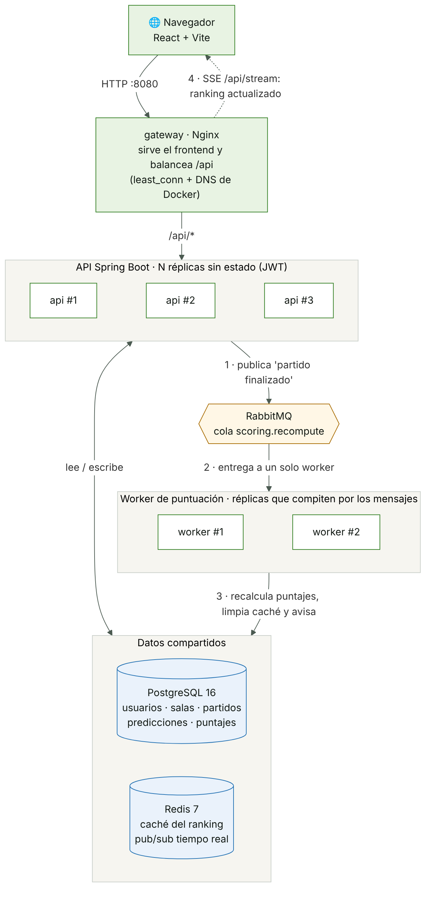
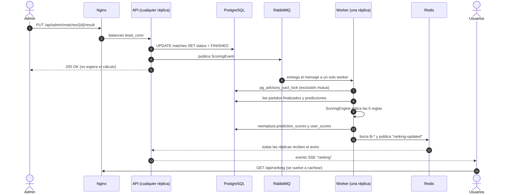
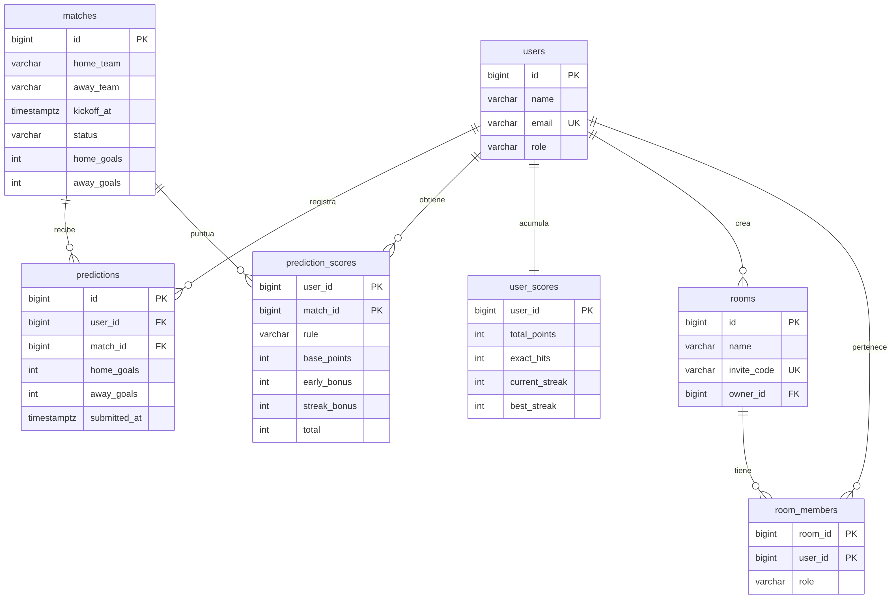

# Propuesta de arquitectura

## 1. Idea general

La aplicación es una app de pronósticos: los participantes pronostican el marcador de cada partido y suman puntos según qué tan cerca estuvieron. Desde el inicio la pensamos para que **pueda crecer horizontalmente**, es decir, que si llegan más usuarios basta con levantar más copias del backend en lugar de comprar un servidor más grande.

Para lograrlo, la arquitectura separa tres responsabilidades:

1. **Atender a los usuarios rápido** → la API, que no guarda estado y se replica.
2. **Calcular los puntajes** → un worker aparte, que trabaja en segundo plano a partir de eventos.
3. **Guardar y compartir datos** → PostgreSQL, Redis y RabbitMQ, que todas las réplicas usan por igual.

## 2. Componentes

| Componente | Tecnología | Para qué sirve | Réplicas |
|---|---|---|---|
| gateway | Nginx 1.28 | Sirve el frontend compilado y **balancea** `/api/*` entre las réplicas de la API | 1 |
| api | Spring Boot 3.5 (Java 21) | Registro e inicio de sesión (JWT), partidos, pronósticos, salas, ranking y panel admin | 3 (escalable) |
| worker | Spring Boot 3.5 + Spring AMQP | Consume eventos y recalcula todos los puntajes con el motor de reglas | 2 |
| scoring-core | Java puro | Motor de puntuación con las 5 reglas; lo comparten la API y el worker | (librería) |
| postgres | PostgreSQL 16 | Datos persistentes; el esquema se versiona con Flyway | 1 |
| redis | Redis 7 | Caché del ranking y canal pub/sub para avisos en tiempo real | 1 |
| rabbitmq | RabbitMQ 3.13 | Cola `scoring.recompute` entre la API y el worker | 1 |
| frontend | React 18 + Vite | Interfaz web (partidos, salas, ranking, estadísticas, reglas, admin) | — |

## 3. Decisiones de diseño

### 3.1 API sin estado

Cada réplica de la API puede atender cualquier petición porque **no guarda sesiones en memoria**:

- La sesión viaja en un **JWT** firmado con un secreto que comparten todas las réplicas. Así, un token emitido por `api #1` lo valida `api #3` sin consultar a nadie.
- La caché del ranking vive en **Redis**, no en la memoria de cada réplica, así que todas ven lo mismo.
- La hora de cada pronóstico la pone **PostgreSQL** (`now()`), así que no importa si los relojes de los contenedores difieren un poco.

Gracias a esto, el balanceador no necesita "sticky sessions" y se puede usar `least_conn`, que manda cada petición a la réplica menos ocupada.

### 3.2 Balanceo de carga con Nginx

Nginx resuelve el nombre `api` con el DNS interno de Docker, que devuelve **una IP por réplica**. Con la opción `resolve`, Nginx vuelve a consultar ese DNS cada 5 segundos, así que al hacer `docker compose up --scale api=5` las réplicas nuevas empiezan a recibir tráfico solas, sin reiniciar nada. Además:

- Cada respuesta lleva la cabecera `X-Instance-Id`, con la réplica que atendió, y `X-Upstream`, con su IP. El pie de página del frontend muestra la réplica en vivo.
- Si una réplica cae, `proxy_next_upstream` reintenta la petición en otra.

### 3.3 Cálculo de puntos asíncrono con RabbitMQ

Cuando el admin registra un resultado, la API **no calcula los puntos ella misma**. Solo guarda el marcador y publica un evento en RabbitMQ. Esto tiene dos ventajas:

- La petición del admin responde al instante, aunque haya miles de participantes.
- El cálculo no compite por CPU con los usuarios que están navegando.

Con dos réplicas del worker, RabbitMQ entrega cada mensaje **a una sola** (patrón *competing consumers*). Si un worker se cae a mitad del cálculo, el mensaje no se confirma y lo toma el otro.

### 3.4 Idempotencia y exclusión mutua

El worker no "suma" puntos al total anterior, sino que **recalcula todo desde cero** a partir de los partidos finalizados. El motor de reglas es una función pura, así que procesar el mismo evento dos veces deja exactamente el mismo resultado: no hay puntos duplicados.

Para que dos workers no escriban a la vez, el recálculo toma un **advisory lock de PostgreSQL** (`pg_advisory_xact_lock`), que se libera solo al terminar la transacción. La tabla `scoring_runs` guarda qué réplica procesó cada evento, y eso sirve como evidencia en el panel admin.

### 3.5 Tiempo real

Cuando el worker termina, publica un aviso en un canal de Redis. **Todas** las réplicas de la API están suscritas y reenvían el aviso a sus navegadores conectados por *Server-Sent Events* (`/api/stream`). Así el ranking se actualiza en pantalla sin recargar, aunque cada usuario esté conectado a una réplica distinta.

## 4. Flujo al registrar un resultado

## 5. Modelo de datos

- `predictions` tiene una restricción única `(user_id, match_id)`: un pronóstico por persona y partido. Editarlo actualiza `submitted_at`, que es la hora que cuenta para la regla 5.
- `prediction_scores` guarda el desglose por partido: regla aplicada, bonus por anticipación, bonus por racha y total.
- `user_scores` guarda los totales y las rachas, con índice por puntos para ordenar el ranking rápido.
- `rooms` tiene un `invite_code` único de 8 caracteres, sin letras ambiguas como O/0 o I/1.

## 6. Salas (grupos) con invitación

| Acción | Quién |
|---|---|
| Crear sala (se genera el código) | Cualquier participante |
| Ver vista previa con `/unirse/CODIGO` y unirse | Quien tenga el código o enlace |
| Ver ranking y miembros de la sala | Solo miembros |
| Editar nombre o descripción, regenerar código, expulsar miembros, eliminar la sala | Solo el dueño |
| Abandonar la sala | Miembros (el dueño no, debe eliminarla) |

## 7. Monitoreo (opcional)

Con `docker compose --profile monitoring up -d` se levantan Prometheus y Grafana. Prometheus descubre las réplicas por DNS y el tablero **"Marcador 26 · Escalamiento"** muestra peticiones por segundo, latencia p95, CPU y memoria **por réplica**, y cuántos recálculos hizo cada worker.
